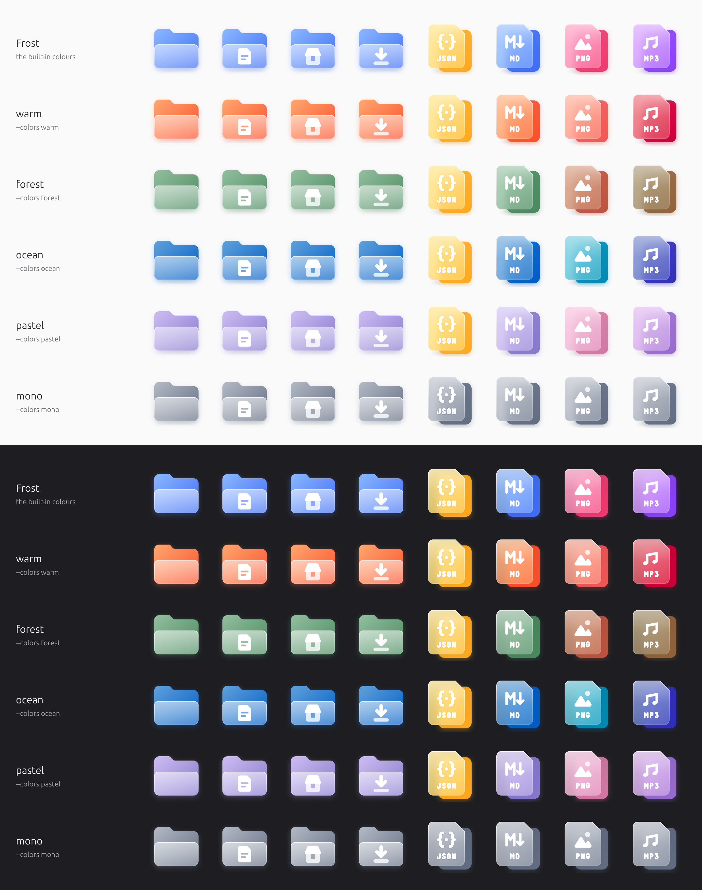

# Frost

**A frosted-glass icon theme for Linux** — folders, apps, 134 file types and top-bar status icons, each one a
vivid colour seen through a soft pane of frosted glass, with a crisp white symbol on top. For GNOME, KDE Plasma
and COSMIC, in Frost's colours or [yours](#make-it-yours).


```sh
curl -fsSL https://raw.githubusercontent.com/thissayantan/frost-icon-theme/main/install.sh | sh
```
Then pick **Frost** in *GNOME Tweaks → Appearance → Icons* (or run
`gsettings set org.gnome.desktop.interface icon-theme 'Frost'`); on KDE, *System Settings → Colours & Themes →
Icons*; on COSMIC, *Settings → Desktop → Appearance*.

## Why Frost
- **One glass language everywhere** — the same two shapes and a glyph for folders, places, apps and files.
  No macOS lookalikes, no brand logos, no mixed styles.
- **File types that say what they are** — JSON is `{ }`, Markdown is `M↓`, a lock file is a padlock, a
  certificate is a rosette, a Dockerfile is a stack of crates. Colour tells the *kind*, and from 48 px a short
  label (JSON, MD, PEM, LOCK, GO…) tells the exact type. [All 134 file types →](docs/preview-filetypes.png)
- **Fixes for developer files** — GNOME types `bun.lock`, `.env`, Dockerfiles and `.gitignore` as plain text,
  `.ts` as a Qt translation file and `go.mod` as a *tracker-music module*. The optional MIME add-on
  (`--mime`) gives them real types, per user, reversibly.
- **Top-bar status icons you can read** — Wi-Fi, VPN, Bluetooth, volume, microphone (orange while in use),
  battery with charging/charged marks, night light: pixel-exact at 16 px, recoloured by GNOME Shell.
- **Crisp at every size** — small sizes are hand-drawn on the pixel grid, not scaled down. HiDPI `@2x` included.


## Install
**One line** (downloads the latest release to `~/.local/share/icons/Frost`; never changes your theme):
```sh
curl -fsSL https://raw.githubusercontent.com/thissayantan/frost-icon-theme/main/install.sh | sh
# with the developer file-type fixes:
curl -fsSL https://raw.githubusercontent.com/thissayantan/frost-icon-theme/main/install.sh | sh -s -- --mime
```
Also on [gnome-look.org](https://www.gnome-look.org/p/2372226/).

**Manual:** download `Frost-v*.tar.xz` from [Releases](https://github.com/thissayantan/frost-icon-theme/releases),
extract it, and copy the `Frost` folder to `~/.local/share/icons/`.

**Arch:** the one-liner works there too; an AUR package will follow once AUR registration reopens.

**Recommended:** install [Papirus](https://github.com/PapirusDevelopmentTeam/papirus-icon-theme) too
(`sudo apt install papirus-icon-theme`). Frost only ships icons it has redrawn well; everything else falls back to
Papirus, then Adwaita.

**Uninstall:** `sh install.sh --uninstall` (removes the theme and the MIME add-on), then pick another icon theme.

## Make it yours
Prefer coral folders, a green JSON icon or everything in soft pastels? **[Open the colour builder](https://thissayantan.github.io/frost-icon-theme/)**,
pick colours while the real icons change in front of you, and copy the one command it gives you.



**Ready-made sets** — one flag each:

| Preset | What it does |
|---|---|
| `warm` | coral folders; apricot, amaranth and salmon in place of Frost's cool colours |
| `forest` | sage folders; moss, terracotta and bark instead of blues and violets |
| `ocean` | deep-water blue folders; lagoon teal and indigo accents |
| `pastel` | lavender folders; soft, chalky colours everywhere |
| `mono` | one quiet grey for every folder and file; apps keep their colour |

```sh
curl -fsSL https://raw.githubusercontent.com/thissayantan/frost-icon-theme/main/install.sh | sh -s -- --colors warm
```

**Your own colours** — a small `frost.colors.json`, written by the builder or by hand:
```json
{
  "$schema": "https://raw.githubusercontent.com/thissayantan/frost-icon-theme/main/schema/frost-colors.schema.json",
  "folders": "coral",
  "filetypes": { "json": "seagreen", "markdown": "#E8573C" },
  "palette": { "violet": "#E52B50" },
  "icons": { "user-home": "gold" }
}
```
```sh
sh install.sh --colors frost.colors.json          # a file
sh install.sh --colors 'https://…/?c=…'           # a link from the colour builder (your colours are inside it)
sh install.sh --colors https://…/my.colors.json   # a file on the web, e.g. a gist
```
- **One colour is enough.** Any CSS colour works (`coral`, `#E8573C`, `rgb(…)`, `oklch(…)`); Frost works out the
  glass gradient from it. For exact control give both ends: `{ "light": "#FFD1C2", "deep": "#C2410C" }`.
- **Change only what you name.** `folders` for every folder; `filetypes` for all file types or one kind (`json`,
  `markdown`, `archive`, `image`…); `palette` swaps one of Frost's nine colours everywhere; `icons` targets one
  icon. Everything else keeps Frost's colours.
- **Mistakes are caught.** The `$schema` line gives your editor autocomplete; the installer says *did you mean
  "folders"?* and warns when a colour is too light for the white symbols on top.
- **What the installer does:** it explains every step and asks first. Custom colours are drawn on your machine,
  so it downloads the source and uses [Bun](https://bun.sh) (installed only if you say yes), takes a minute or
  two, and installs over `~/.local/share/icons/Frost`. It keeps your colours inside the theme, so an upgrade asks
  whether to re-apply them. Back to Frost's own colours: run the plain one-liner.

## Compatibility
Made on **GNOME 50 / GTK 4.22, Ubuntu 26.04**; also made for **KDE Plasma 6** and **COSMIC**. The glass is baked
into PNGs (16–256 px, `@2x`), so it looks the same in GTK 4, GTK 3, Qt/KDE apps and the GNOME Shell app grid.
- **KDE Plasma:** pick Frost in *System Settings → Colours & Themes → Icons*. Tray icons follow your colour
  scheme, drawn crisp at the tray's 22 px. Dolphin, Konsole, Kate, Okular, Gwenview, Spectacle, Discover, Ark,
  Elisa, KDE Connect and more are covered; KDE's own logo stays KDE's.
- **COSMIC:** pick Frost in *Settings → Desktop → Appearance*. COSMIC Files, Terminal, Settings, Edit, Store,
  Player and Screenshot plus the panel's battery, Bluetooth and notification icons are covered.
- Status icons are plain symbolic SVG, recoloured by GNOME Shell, KDE and COSMIC alike.

<details><summary>Every size is checked, not just the big one</summary>


</details>

## The story behind it
Why the default icons bothered me, how the project-stack folder marks work, and what Linux actually thinks
your files are (`.ts` is a Qt translation file, `go.mod` is tracker music):
[dev.to](https://dev.to/thissayantan/linux-desktop-icons-are-dull-so-i-drew-a-better-set-and-made-it-free-5af0)
· [Medium](https://medium.com/p/264f1286361b)
· [LinkedIn](https://www.linkedin.com/pulse/linux-desktop-icons-dull-so-i-drew-better-set-made-free-sayantan-das-jlkef/)
· [Show HN](https://news.ycombinator.com/item?id=49770157)

## FAQ
**Why isn't Firefox / Chrome / VS Code themed?** Frost never redraws trademarked logos. Brand apps keep their
own icon (via Papirus), which is also what their makers ask for.

**An icon I use is missing.** [Request it](https://github.com/thissayantan/frost-icon-theme/issues/new/choose) —
include the app's `Icon=` name (from its `.desktop` file) or the file's type (`gio info -a standard::icon FILE`).

## Build it yourself
Requires [Bun](https://bun.sh) and Python 3.
```sh
bun install
bun run build           # src/**/*.svg → dist/Frost (PNG @1x/@2x, aliases, index.theme, icon cache)
bun run verify          # lint + index.theme checks + real GTK, KDE (KIconLoader) and Qt lookup of every name
bun run build --colors presets/warm.json   # a custom-colour build (preview first: bun run preview --colors warm)
bun run install:local   # → ~/.local/share/icons/Frost (+ MIME add-on)
bun run pack            # → dist/Frost-v<version>.tar.xz
```
Design rules: [`docs/DESIGN.md`](docs/DESIGN.md). Pipeline and decisions: [`docs/ARCHITECTURE.md`](docs/ARCHITECTURE.md).
How to contribute: [`CONTRIBUTING.md`](CONTRIBUTING.md). Shipped vs inherited: [`docs/COVERAGE.md`](docs/COVERAGE.md).

## Credits
- Visual direction inspired by **Glassmorphism – Glass Icon set (Free)** by
  [Kristaps Elsiņš / uibits](https://www.figma.com/community/file/1389159203053638214/glassmorphism-glass-icon-set-free)
  (CC BY 4.0). Frost's artwork is original — no geometry was copied.
- The Markdown mark (`M↓`) is by Dustin Curtis, public domain (CC0).
- Fallback icons: [Papirus](https://github.com/PapirusDevelopmentTeam/papirus-icon-theme), Adwaita.
  Rendering: [resvg](https://github.com/linebender/resvg).
- Built with a lot of help from Claude Code (design reviews, pipeline, pixel hinting).

## License
[MIT](LICENSE) — icons and tools alike. Use it, change it, ship it.
