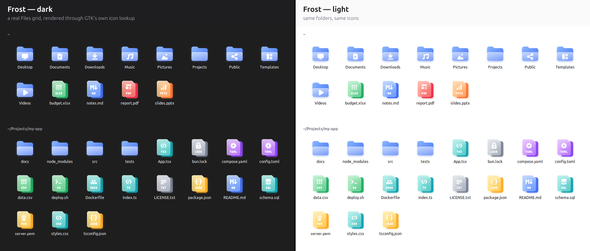
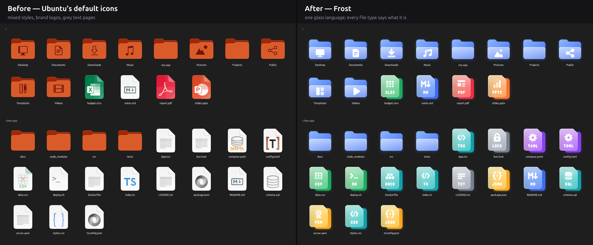
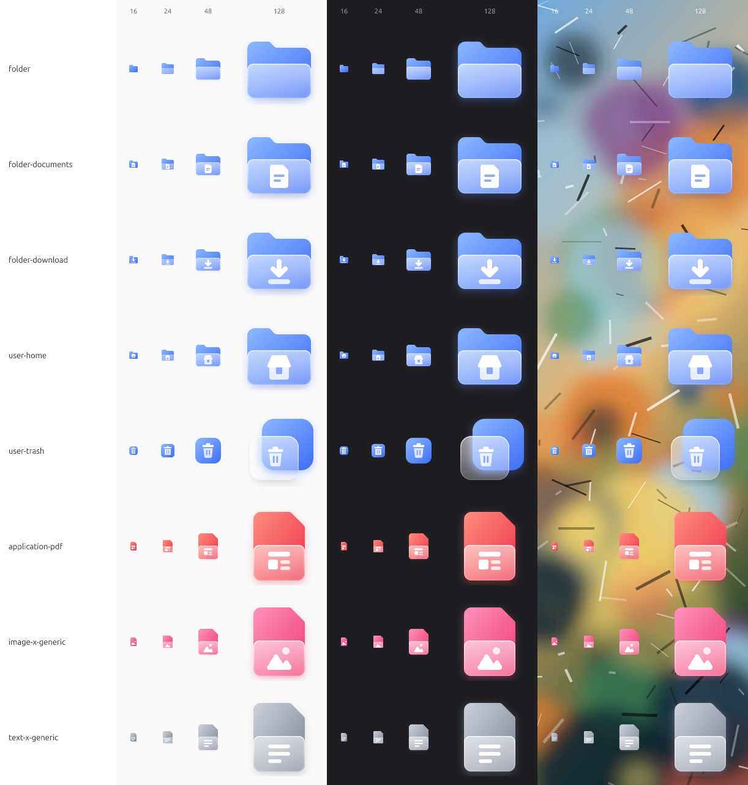
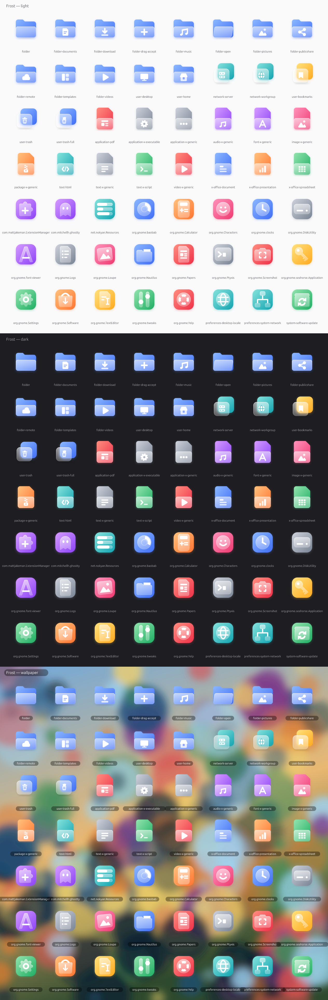

# Frost

**A frosted-glass icon theme for Linux** — folders, apps, 134 file types and top-bar status icons, each one a
vivid colour seen through a soft pane of frosted glass, with a crisp white symbol on top.



```sh
curl -fsSL https://raw.githubusercontent.com/thissayantan/frost-icon-theme/main/install.sh | sh
```
Then pick **Frost** in *GNOME Tweaks → Appearance → Icons* (or run
`gsettings set org.gnome.desktop.interface icon-theme 'Frost'`).

## Why Frost
- **One glass language everywhere** — the same two shapes and a glyph for folders, places, apps and files.
  No macOS lookalikes, no brand logos, no mixed styles.
- **File types that say what they are** — JSON is `{ }`, Markdown is `M↓`, a lock file is a padlock, a
  certificate is a rosette, a Dockerfile is a stack of crates. Colour tells the *kind*, and from 48 px a short
  label (JSON, MD, PEM, LOCK, GO…) tells the exact type. [All 134 file types →](docs/preview-filetypes.png)
- **Fixes for developer files** — GNOME types `bun.lock`, `.env`, Dockerfiles and `.gitignore` as plain text,
  `.ts` as a Qt translation file and `go.mod` as a *tracker-music module*. The optional MIME add-on
  (`--mime`) gives them real types, per user, reversibly.
- **Top-bar status icons you can read** — Wi-Fi, VPN, Bluetooth, volume, microphone (orange while in use),
  battery with charging/charged marks, night light: pixel-exact at 16 px, recoloured by GNOME Shell.
- **Crisp at every size** — small sizes are hand-drawn on the pixel grid, not scaled down. HiDPI `@2x` included.



## Install
**One line** (downloads the latest release to `~/.local/share/icons/Frost`; never changes your theme):
```sh
curl -fsSL https://raw.githubusercontent.com/thissayantan/frost-icon-theme/main/install.sh | sh
# with the developer file-type fixes:
curl -fsSL https://raw.githubusercontent.com/thissayantan/frost-icon-theme/main/install.sh | sh -s -- --mime
```
Also on [gnome-look.org](https://www.gnome-look.org/p/2372226/).

**Manual:** download `Frost-v*.tar.xz` from [Releases](https://github.com/thissayantan/frost-icon-theme/releases),
extract it, and copy the `Frost` folder to `~/.local/share/icons/`.

**Arch:** the one-liner works there too; an AUR package will follow once AUR registration reopens.

**Recommended:** install [Papirus](https://github.com/PapirusDevelopmentTeam/papirus-icon-theme) too
(`sudo apt install papirus-icon-theme`). Frost only ships icons it has redrawn well; everything else falls back to
Papirus, then Adwaita.

**Uninstall:** `sh install.sh --uninstall` (removes the theme and the MIME add-on), then pick another icon theme.

## Compatibility
Made and tested on **GNOME 50 / GTK 4.22, Ubuntu 26.04**. The glass is baked into PNGs (16–256 px, `@2x`), so
it looks the same in GTK 4, GTK 3, Qt/KDE apps and the GNOME Shell app grid. Status icons are plain symbolic SVG
so the shell can recolour them.

<details><summary>Every size is checked, not just the big one</summary>



</details>

## FAQ
**Why isn't Firefox / Chrome / VS Code themed?** Frost never redraws trademarked logos. Brand apps keep their
own icon (via Papirus), which is also what their makers ask for.

**An icon I use is missing.** [Request it](https://github.com/thissayantan/frost-icon-theme/issues/new/choose) —
include the app's `Icon=` name (from its `.desktop` file) or the file's type (`gio info -a standard::icon FILE`).

## Build it yourself
Requires [Bun](https://bun.sh) and Python 3.
```sh
bun install
bun run build           # src/**/*.svg → dist/Frost (PNG @1x/@2x, aliases, index.theme, icon cache)
bun run verify          # lint + index.theme checks + real GTK lookup of every shipped name
bun run install:local   # → ~/.local/share/icons/Frost (+ MIME add-on)
bun run pack            # → dist/Frost-v<version>.tar.xz
```
Design rules: [`docs/DESIGN.md`](docs/DESIGN.md). Pipeline and decisions: [`docs/ARCHITECTURE.md`](docs/ARCHITECTURE.md).
How to contribute: [`CONTRIBUTING.md`](CONTRIBUTING.md). Shipped vs inherited: [`docs/COVERAGE.md`](docs/COVERAGE.md).

## Credits
- Visual direction inspired by **Glassmorphism – Glass Icon set (Free)** by
  [Kristaps Elsiņš / uibits](https://www.figma.com/community/file/1389159203053638214/glassmorphism-glass-icon-set-free)
  (CC BY 4.0). Frost's artwork is original — no geometry was copied.
- The Markdown mark (`M↓`) is by Dustin Curtis, public domain (CC0).
- Fallback icons: [Papirus](https://github.com/PapirusDevelopmentTeam/papirus-icon-theme), Adwaita.
  Rendering: [resvg](https://github.com/linebender/resvg).
- Built with a lot of help from Claude Code (design reviews, pipeline, pixel hinting).

## License
[MIT](LICENSE) — icons and tools alike. Use it, change it, ship it.
